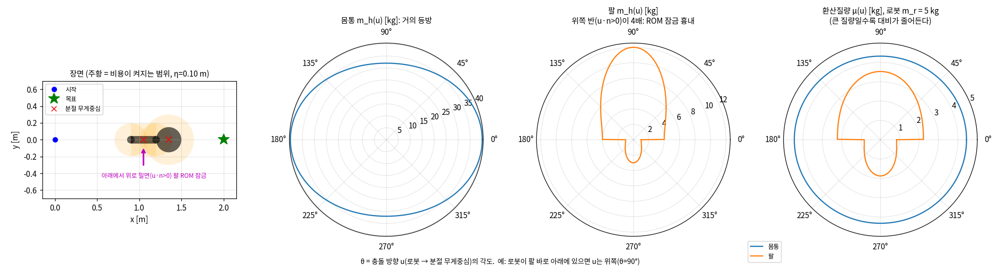

# 노트 14~22 공통 모듈 `common14` (회차 0)

14~21의 모든 노트는 이 폴더의 장면과 함수를 그대로 쓴다. **수치는 `scene.py`에 고정**하고, 각 노트는 한 요인만 바꾼다.
모든 계산은 numpy(CPU)만 쓴다.

`python.sh common14/scene_check.py`로 다시 만들 수 있다.

## 파일

| 파일 | 내용 |
|---|---|
| `scene.py` | 고정 수치: 시작·목표, 로봇 반지름·유효질량, 사람 분절 모양, 분절 관성 행렬, MPPI·비용 설정 |
| `geometry.py` | 점-원·점-캡슐 거리, 분절별 간격, 가장 가까운 분절과 충돌 방향 u, 분절 무게중심 방향 |
| `mass.py` | 방향 유효질량 m_h(u) = 1/(uᵀM⁻¹u) (팔은 ROM 잠금 쪽 4배), 환산질량 μ |
| `mppi.py` | 2D 점 rollout, η 비용(08), 목표 비용, 균일 η 사람 비용, MPPI 한 번 갱신(05), 사람이 움직이는 MPC 루프(예측: 정지/등속/오라클), x축 위로만 움직이는 1D MPC 루프 `run_mpc_line`(15에서 추가), 방향별 η `directional_eta`와 그 사람 비용 `human_cost_directional`(16에서 추가), σ·β·K를 바꿀 수 있고 반복별 ESS·사람 비용 후보 비율을 기록하는 `run_mpc_opts`(17에서 추가, 기본값이면 run_mpc(정지 예측)·run_mpc_line과 같은 결과) |
| `pose.py` | 기준 자세가 아닌 사람 자세를 새 이름으로 만드는 함수(16의 7절에서 추가): `make_pose`(몸통 위치·팔 방향·잠금 방향), 자세별 간격·가장 가까운 분절·방향 질량·η 비용, `draw_pose`. 16의 8절에서 비교용 u 정의(로봇 점 → 분절 표면의 가장 가까운 점) 함수 `pose_nearest_point`, `pose_directional_eta_point`, `pose_cost_directional_point`를 추가했다(기본 u 정의는 무게중심 방향 그대로). 기본 장면의 수치는 쓰기만 하고 바꾸지 않는다 |
| `motion.py` | 사람의 참 움직임: 정면 접근, 경로 가로지르기, 오다가 되돌아가기 |
| `metrics.py` | 최소 이격, 이격 시계열, 도달 시간, ESS, 명령 변화량, 경로 길이, 회피 시작 시각 |
| `plot.py` | 그림 스타일(01~13과 같음), 평면 사람 그리기, 방향-질량 극좌표 |
| `scene_check.py` | 장면 확인 그림 생성 |

## 고정한 수치와 이유

### 과제

| 항목 | 값 | 이유 |
|---|---|---|
| 시작 / 목표 | (0, 0) → (2.0, 0) m | 로봇이 약 1 m/s로 2초 남짓 움직인다. 사람을 지나치는 구간이 실행 중간에 오고, 지나친 뒤 도달까지 볼 수 있다 |
| 로봇 반지름 | 0.05 m | 05·06과 같음 |
| 로봇 유효질량 m_r | 5 kg, 방향과 무관한 상수 | franka-depth-mppi 프로젝트의 가정값과 같음 |

### 평면 사람 (위에서 본 모습, 기준 자세)

| 분절 | 모양 | 값 | 이유 |
|---|---|---|---|
| 몸통 | 원 | 중심 (1.35, 0), 반지름 0.15 m | 위에서 본 가슴 폭 약 0.3 m |
| 팔 | 캡슐 | (1.20, 0) → (0.90, 0), 반지름 0.045 m | 아래팔 길이 약 0.3 m. 로봇 쪽으로 뻗고 있음 |

사람은 로봇 경로(y=0) 위에 서서 팔을 로봇 쪽으로 뻗고 있다. 경로가 막혀 있어서 로봇은 위(+y) 또는 아래(−y)로 돌아가야 한다. **위·아래 모양이 대칭이므로 어느 쪽으로 갈지는 질량(16) 같은 비용 요인만으로 정해진다.** 질량이 없는 14·15에서는 대칭이라 seed에 따라 어느 쪽이든 갈 수 있다.

### 분절 관성 (주어진 값으로만 사용)

방향 u로 밀 때 유효질량 m_h(u) = 1/(uᵀ M⁻¹ u). u는 로봇 점에서 분절 무게중심으로 향하는 단위벡터.

| 분절 | 행렬 M (월드 좌표) | 의도 |
|---|---|---|
| 몸통 | diag(40, 32) kg | 거의 등방. ISO/TS 15066의 가슴 유효질량(40 kg)과 같은 자릿수 |
| 팔 (잠기지 않은 쪽) | 길이 방향(x) 1 kg, 수직 방향(y) 3 kg | "길이 방향은 가볍고 수직은 무겁다". 위팔·아래팔 유효질량(약 2~3 kg)과 같은 자릿수 |
| 팔 (ROM 잠금 쪽) | 위 값의 4배 → 길이 4 kg, 수직 12 kg | u·n > 0 (n = +y, 로봇이 팔 아래에서 위로 밀 때)이면 관절이 ROM 끝에 걸려 몸통 일부가 함께 밀리는 상황을 흉내 |

- **ROM 경계에서 값이 뛴다.** u가 팔 길이 방향(θ = 0°, 180°)을 지날 때 1 kg ↔ 4 kg으로 불연속이다. 18에서 이 불연속이 만드는 떨림을 다루기 위해 일부러 매끄럽게 하지 않았다. 경계(u·n = 0 정확히)는 잠기지 않은 쪽으로 판정한다.
- 환산질량으로 바꾸면 대비가 줄어든다. 팔 수직 방향은 잠금 12 kg / 자유 3 kg = **4배**인데, μ로는 3.53 / 1.88 = **1.88배**다. 몸통과 팔(자유, 수직)도 40/3 = 13배 → 4.44/1.88 = 2.4배. 16에서 이 압축을 다룬다.

| 분절 | θ (u 방향) | m_h [kg] | μ [kg] |
|---|---|---:|---:|
| 몸통 | 0°, 180° | 40.0 | 4.444 |
| 몸통 | 90°, 270° | 32.0 | 4.324 |
| 팔 | 0°, 180° (길이 방향, 경계) | 1.0 | 0.833 |
| 팔 | 90° (로봇이 아래, 잠금) | 12.0 | 3.529 |
| 팔 | 270° (로봇이 위, 자유) | 3.0 | 1.875 |

### MPPI와 비용 (05·06과 같은 기본형)

| 항목 | 값 | 이유 |
|---|---|---|
| Δt, T | 0.05 s, 30칸 → 1.5 s 앞까지 | 06과 같음. 사람 보행 0.5 m/s면 1.5 s 동안 0.75 m 움직여 예측 차이가 드러나는 길이 |
| K, β, σ | 400, 1.0, 2.0 m/s² (고정) | 06과 같음. K는 cuRobo와 같음 |
| 스텝당 갱신 | 5회 | cuRobo `n_iters`와 같음 (06은 1회) |
| 가속도 한계 | ±4 m/s² (clamp) | 06과 같음 |
| 출력 | 가중평균 μ의 첫 입력, 다음 스텝에 한 칸 shift (warm start) | 05·06 기본형. 06에서 MPC 루프 안에서는 가중평균과 BEST의 차이가 작았다 |
| 노이즈 | 매 갱신마다 새 정규 노이즈 (seed 고정) | 05·06 기본형. 결과는 seed 여러 개로 확인한다 |
| 목표 비용 | w_goal 1, w_term 20, w_vterm 1, w_u 1e-3 | `course.point_cost`와 같음 |
| 사람 비용 | w = 100, 균일 η = 0.10 m, 가장 가까운 분절의 간격에 η 비용 | 06과 같음. 15부터 η 또는 w를 질량으로 바꾼다 |
| 실행 길이 | 100스텝 = 5 s, 도달 판정 0.05 m | |

**22에서 확인할 항목:** 이 노트들의 예측 길이는 1.5 s(Δt 0.05 s × 30칸)이고, franka-depth-mppi 최종 실험의 cuRobo MPC는 0.675 s(30칸 가변 dt, base 1/60 s, 09에서 계산)다. 14~21의 결과가 짧은 예측 길이에서도 유지되는지 22에서 확인한다.

### 사람 움직임 (`motion.py`)

| 이름 | 움직임 | 쓰는 노트 |
|---|---|---|
| `frontal` | 기준 자세에서 출발해 −x(로봇 쪽)로 0.5 m/s | 14 |
| `crossing` | 기준 자세보다 +0.6 m 위에서 출발해 −y로 0.5 m/s, t = 1.2 s에 기준 자세를 지나 계속 감 | 14 |
| `turn_back` | crossing처럼 오다가 t = 0.6 s에 되돌아감(+y, 0.5 m/s) | 14 |

보행 속도 0.5 m/s는 천천히 걷는 속도다. 움직임은 모두 기준 자세를 지나거나 기준 자세에서 출발하도록 정의해 장면 수치를 바꾸지 않는다.

## 지표 정의 (`metrics.py`)

| 지표 | 정의 |
|---|---|
| 최소 이격 | 실행 전체에서 로봇 원 표면과 가장 가까운 분절 표면 사이 거리의 최솟값 (참 사람 위치 기준). 음수면 겹침 |
| 도달 시간 | 목표 0.05 m 안에 처음 들어간 시각 |
| ESS | 유효 샘플 수 (Σw)²/Σw². 가중치가 하나에 몰리면 1, 고르게 퍼지면 K |
| 명령 변화량 | 실행한 가속도 명령의 스텝 간 변화 ‖u_t − u_{t−1}‖의 평균 (떨림) |
| 회피 시작 시각 | 경로 직선에서 |y| > 0.05 m로 처음 벗어난 시각 |
